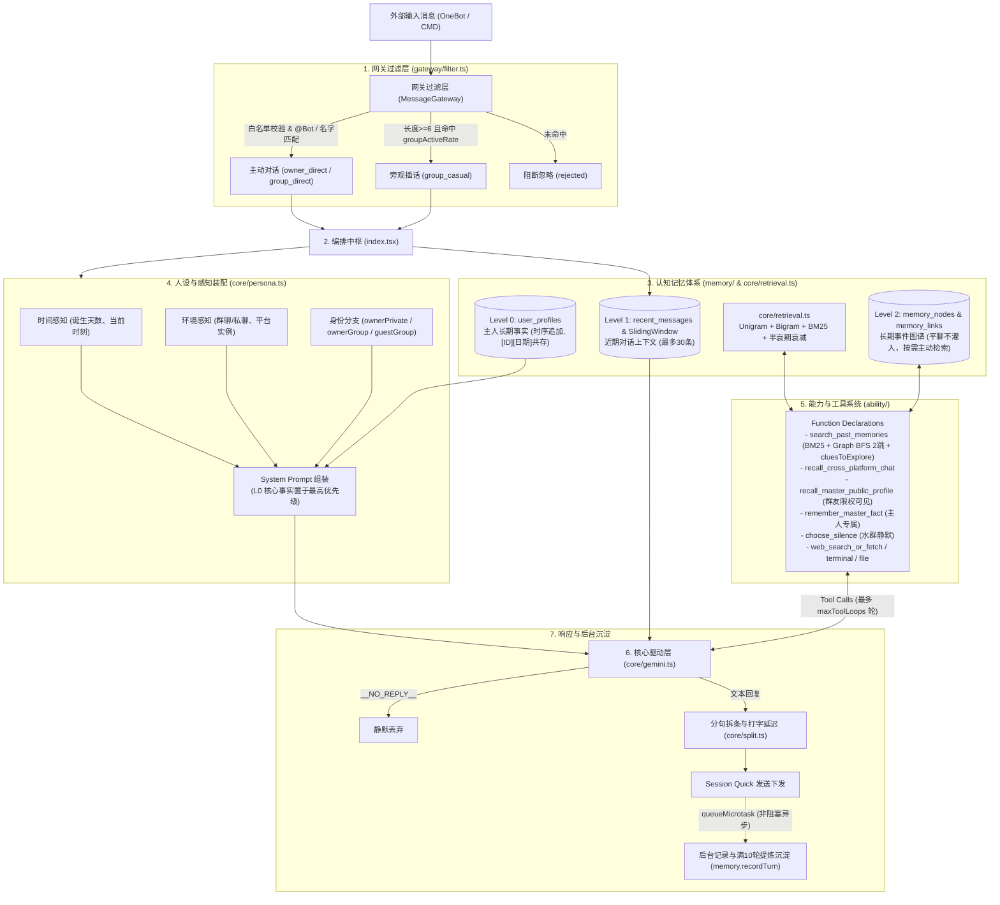

# AnimaOne

基于 Kotori 框架的认知伴侣与高级智能体插件，驱动具有深度记忆感知、拟真人设及多工具调用闭环能力的交互体验。

---

## 核心特性



- **三级认知记忆系统**
  - **Level 0（核心画像与长期事实）**：存储于 `user_profiles`，无条件注入 Prompt 最高执行区。支持绝对时间戳 `[ID][YYYY/MM/DD]`，采用“时序共存”机制，新旧偏好发生改变时物理追加、拒绝 CRUD 暴力覆盖，由大模型根据时间推移自主感知打脸与偏好演化。
  - **Level 1（活跃对话工作区）**：存储于 `recent_messages`，维持严格的滑动窗口（Sliding Window），负责当前会话任务的无缝连贯。
  - **Level 2（潜意识图谱与长远历史）**：存储于 `memory_nodes` 与 `memory_links`。平聊时不主动向上下文倾倒垃圾节点，依靠工具主动按需召回。

- **纯 TS 高性能检索引擎**
  - 中文无词典切词（Unigram 单字 + Bigram 双字滑窗），结合内置停用词表过滤。
  - 标准 BM25 相关度评分结合 30 天指数半衰期时间衰减算法（`rankDocuments`），彻底替代粗暴的 SQL `LIKE` 模糊匹配。

- **Graph RAG 与顺藤摸瓜联想**
  - 基于概念关联边（`memory_links`）的有界 BFS 图遍历（`traverseGraph`）。
  - 在召回相关记忆的同时提取边缘关联概念词作为发散线索（`cluesToExplore`），驱动大模型沿着思考链展开多步深层求证。

- **拟真人设与全方位感知**
  - **时间感知**：感知墙上钟时间（东八区）、自身诞生时刻与存活天数，具备时间流逝认知。
  - **权限与环境分流**：严格隔离主人私聊（`ownerPrivate`）、主人在群（`ownerGroup`）与普通群友（`guestGroup`）。普通群友对话中绝不泄漏主人隐私设定，杜绝认错人。
  - **拟真打字体验**：支持智能分句与自然打字延迟（`enableHumanDelay`），代码块与文件内容完整保留。

- **灵活网关与旁观插话**
  - 支持跨平台白名单、群聊白名单过滤。
  - 支持 `@Bot` 主动唤醒，以及根据群活跃概率（`groupActiveRate`）与长句过滤的随机旁观插嘴。
  - 配备自主静默工具（`choose_silence`），大模型认为无聊时可自主保持闭嘴。

- **完备能力工具集（Ability）**
  - `search_past_memories`：结合 BM25 与图谱 BFS 发散，翻阅久远历史与线索。
  - `remember_master_fact`：主人专用，实时沉淀关键事实到数据库。
  - `recall_master_public_profile`：群友只读，查询主人允许对外吹嘘的公开信息。
  - `recall_cross_platform_chat`：主人专用，跨平台穿梭调取不同会话的最新原话。
  - 宿主管理工具：安全终端命令执行（`execute_terminal_command`）、文件读写（`file_read_or_write`）、网络搜索与抓取（`web_search_or_fetch`）。

---

## 模块架构

```
modules/chat-ai/src/
├── ability/             # 智能体扩展工具（能力定义、系统状态、网络、终端、文件）
│   ├── index.ts         # AbilityManager 管理器与上下文聚合
│   ├── system.ts        # 系统状态监控能力
│   └── tools.ts         # 核心记忆检索、跨平台召回、命令执行等工具集
├── core/                # 基础核与算法层
│   ├── constants.ts     # 默认人设模版与基础配置常量
│   ├── gemini.ts        # Gemini API 通讯、重试与多轮 Function Calling 循环
│   ├── persona.ts       # 动态 System Prompt 组装与感知注入
│   ├── retrieval.ts     # 纯 TS 中文分词、BM25 评分与时间半衰期衰减
│   └── split.ts         # 智能标点分句保护与打字延迟计算
├── gateway/             # 消息网关层
│   └── filter.ts        # 消息准入、白名单校验与场景判断（Direct / Casual）
├── memory/              # 记忆与存储层
│   ├── context.ts       # 记忆格式化器与时序 Prompt 渲染
│   ├── index.ts         # HierarchicalMemoryService 记忆服务中枢
│   ├── scope.ts         # 会话作用域 ADT（私聊 / 群聊）与解析器
│   ├── sliding-window.ts# 内存滑动窗口队列与 ChatMessage 构造
│   ├── store.ts         # SQLite 数据库底层（5张底表、平滑迁移、BFS图遍历）
│   └── summarizer.ts    # 基于大模型的长记忆提炼压缩与画像提取
└── index.tsx            # 插件入口点、Kotori 中间件与生命周期挂载
```

---

## 配置项说明

在 Kotori 配置文件中，可配置以下参数：

| 配置项 | 类型 | 默认值 | 说明 |
| :--- | :--- | :--- | :--- |
| `apiKey` | `string` | **必填** | Google Gemini API Key |
| `modelName` | `string` | `'gemini-3.5-flash-lite'` | 调用的模型名称（建议 Flash 系列保证响应速度） |
| `proxy` | `string` | `undefined` | HTTP/SOCKS 代理地址（如 `http://127.0.0.1:7890`） |
| `whitelistedGroups` | `string[]` | `[]` | 允许对话或旁观插嘴的群号白名单 |
| `groupActiveRate` | `number` | `0.05` | 群聊未被 `@` 时的随机搭话概率（0.0 ~ 1.0） |
| `botName` | `string` | `'λ'` | 机器人名字 |
| `ownerNick` | `string` | `'大哥哥'` | 默认对主人的称呼（若记忆中有新约定，优先遵从最新记忆） |
| `basePersona` | `string` | *(见常量)* | 基础底色人设设定 |
| `ownerPrivate` | `string` | *(见常量)* | 主人私聊环境下的专属人设提示词 |
| `ownerGroup` | `string` | *(见常量)* | 主人在群聊环境下的交互人设提示词 |
| `guestGroup` | `string` | *(见常量)* | 普通群友在群聊环境下的交互人设提示词（防认错人） |
| `enableHumanDelay` | `boolean` | `true` | 是否启用自然呼吸感的轻量分句与打字发送延迟 |
| `allowedPlatforms` | `string[]` | `['onebot']` | 允许接入的适配器平台列表 |
| `maxToolLoops` | `number` | `10` | 单次交互中允许大模型连续调用工具的最大循环跳数 |

---

## 开发与构建

```bash
# 自动代码格式化与 Biome 检查
pnpm fix

# 编译与构建插件
pnpm build
```
