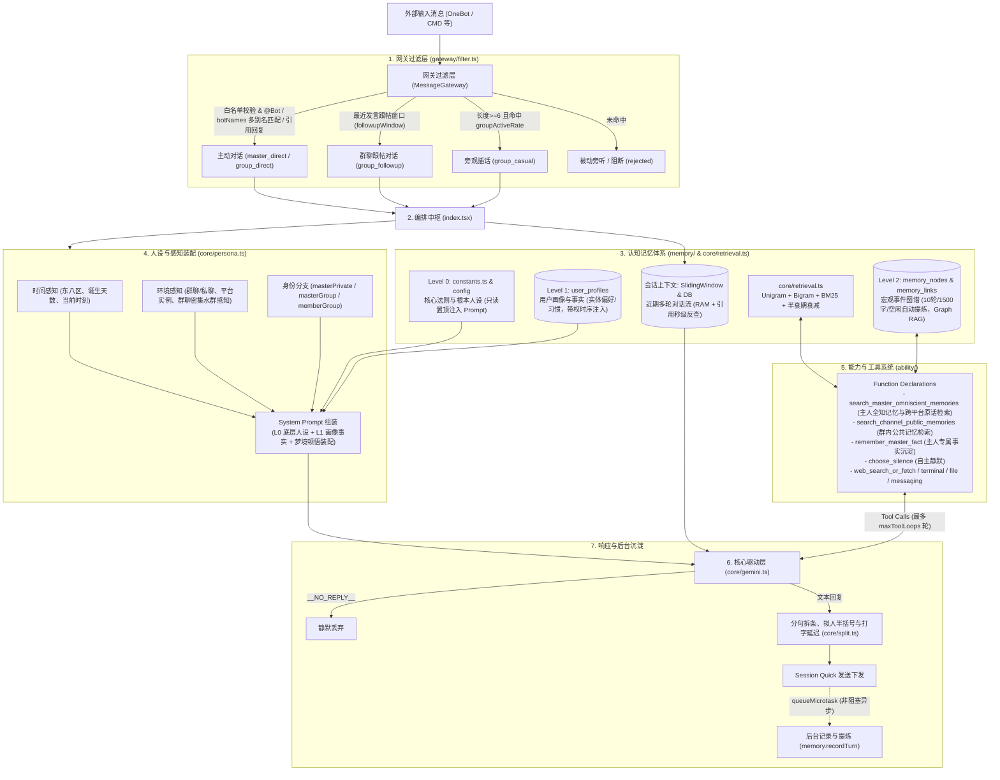

# AnimaOne

基于 Kotori 框架的认知伴侣与高级智能体插件，驱动具有深度分层记忆、多名字别名唤醒、拟真人设及多工具调用闭环能力的交互体验。

---

## 核心特性

- **三级分层认知记忆系统（HierarchicalMemory）**
  - **Level 0（核心法则与根本人设）**：定义于 `constants.ts` 与插件配置中，作为智能体的底层铁律与人格基石，无条件只读常驻注入 System Prompt 最高执行区。
  - **Level 1（用户画像与长期事实）**：存储于 `user_profiles`，沉淀特定用户（如主人 `__master__` 或群友）的实体属性、生活习惯、技术偏好与约定，带权重与时序装配进上下文。
  - **Level 2（宏观事件图谱与 Graph RAG）**：存储于 `memory_nodes` 与 `memory_links`。支持每 10 轮交互、1500 字累计超限或空闲超时自动提炼 Day 级核心摘要与概念标签，平时不占 Prompt，按需主动顺藤摸瓜检索。
  - **会话上下文（非记忆的即时工作流）**：由 RAM `SlidingWindowMemory` 与 SQLite `recent_messages` 驱动，保留最新 `maxTurns` 轮近期对话流，支持群内引用消息（`findQuotedMessage`）秒级检索与白名单群 0 Token 被动旁听。
  - **夜间潜意识顿悟推演（Dream Reflection）**：凌晨 2~5 点在心跳中自动随机抽取记忆节点进行跨界联想推演，生成灵感并于下一次主人私聊时轻柔提起。

- **多别名触发与智能网关**
  - 支持 `botNames` 字符串数组配置多个触发别名（如 `['λ', '小拉姆达']`），首个元素作为默认名，网关自动匹配并清洗剥离所有别名。
  - 拥有主动交互（`master_direct` / `group_direct`）、群聊跟帖会话窗口（`group_followup`）、偶发主动插嘴（`group_casual`）与密集水群感知（`burstThreshold`）。

- **纯 TS 检索引擎与知识图谱联想**
  - 中文无词典切词（Unigram 单字 + Bigram 双字滑窗）结合停用词表。
  - 标准 BM25 相关度评分结合 30 天指数半衰期时间衰减算法（`rankDocuments`）。
  - 基于概念关联边的有界 BFS 图遍历（`traverseGraph`），驱动模型展开多跳顺藤摸瓜联想。

- **拟真人设与全方位感知**
  - **时间与生命感知**：感知墙上钟时间（东八区）、自身诞生时刻与存活天数。
  - **严格权限隔离**：使用框架统一 `master` 语义，严格区分主人私聊（`masterPrivate`）、主人在群（`masterGroup`）与普通群成员（`memberGroup`），严防认错人与隐私泄漏。
  - **拟真打字体验**：支持智能标点分句保护、拟人打字延迟（`enableHumanDelay`）与短句末尾随机半括号变体注入。

- **完备能力工具集（Ability）**
  - `search_master_omniscient_memories`：主人专用，全域搜索历史事件原话与图谱联想线索（可选 query：不传则获取跨平台实时原话与近期事件摘要）。
  - `search_channel_public_memories`：群友只读，检索当前频道的公开历史与图谱关联记忆。
  - `remember_master_fact`：主人专用，实时沉淀关键事实画像。
  - 宿主管理与日常工具：安全终端命令执行（`execute_terminal_command`）、文件读写（`file_read_or_write`）、网络搜索与网页抓取（`web_search_or_fetch`）、自主静默（`choose_silence`）及主动消息推送（`kotori_send_message`）。

---

## 配置项说明

在 Kotori 配置文件中，可配置以下参数：

| 配置项 | 类型 | 默认值 | 说明 |
| :--- | :--- | :--- | :--- |
| `apiKey` | `string` | **必填** | Google Gemini API Key |
| `modelName` | `string` | `'gemini-3.5-flash-lite'` | 调用的模型名称（建议 Flash 系列保证响应速度） |
| `proxy` | `string` | `undefined` | HTTP/SOCKS 代理地址（如 `http://127.0.0.1:7890`） |
| `whitelistedGroups` | `string[]` | `[]` | 允许对话或旁观插嘴的群号白名单（支持纯群号、platform:群号、identity:群号） |
| `allowedInstances` | `string[]` | `[]` | 允许接入响应的适配器实例 identity 列表（留空则不限制全部放行） |
| `groupActiveRate` | `number` | `0.05` | 群聊未被叫到时的随机搭话概率（0.0 ~ 1.0） |
| `botNames` | `string[]` | `['λ']` | 机器人名称列表，第一个为默认名，数组所有名字均可唤醒 |
| `masterNick` | `string` | `'大哥哥'` | 对主人的默认基础称呼（优先遵从画像记忆约定） |
| `basePersona` | `string` | *(见常量)* | 基础底色人设设定 |
| `masterPrivate` | `string` | *(见常量)* | 主人私聊环境下的专属人设提示词 |
| `masterGroup` | `string` | *(见常量)* | 主人在群聊环境下的交互人设提示词 |
| `memberGroup` | `string` | *(见常量)* | 普通群成员在群聊环境下的交互人设提示词（防认错人） |
| `friendPrivate` | `string` | *(见常量)* | 好友在私聊环境下的交互人设提示词 |
| `allowFriendPrivate` | `boolean` | `true` | 是否允许普通好友私聊交互 |
| `identityAspects` | `Record<string, string>` | *(见常量)* | 各实例专属风格特质切面映射 |
| `enableHumanDelay` | `boolean` | `true` | 是否启用自然呼吸感的轻量分句与打字发送延迟 |
| `splitThreshold` | `number` | `120` | 长回复整体发送不拆条的字符长度阈值 |
| `trailingBracketRate` | `number` | `0.08` | 短句末尾随机添加拟人半括号变体的概率 |
| `trailingBracketVariants` | `string[]` | `['（', '）', '（（', '（（（', '（）']` | 短句末尾追加的半括号变体候选列表 |
| `followupWindow` | `number` | `45` | 机器人发言后群友跟帖会话窗口秒数（免随机判定直接放行） |
| `burstThreshold` | `number` | `8` | 判定群聊密集水群触发回复的消息条数阈值（1分钟内） |
| `maxTurns` | `number` | `20` | 短期对话滑动窗口最大保留轮数 |
| `summaryInterval` | `number` | `10` | 自动触发长期记忆归档与提炼的交互轮次间隔 |
| `summaryCharLimit` | `number` | `1500` | 群聊累计字符数超限自动提前触发归档总结的字数阈值 |
| `idleCompactTimeout` | `number` | `300` | 群聊无活动自动触发记忆压缩的空闲秒数 |
| `activeMemoryCapacity` | `number` | `15` | 组装上下文时最多召回的用户画像事实�